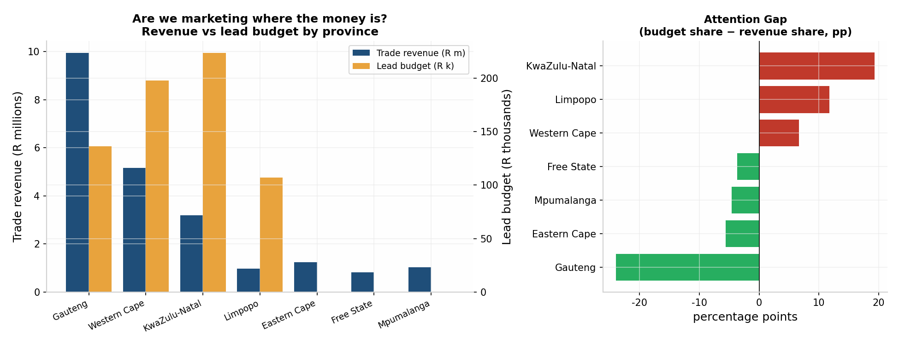

# Executive KPI (Key Performance Indicator) Dashboard: Marketing vs Trade (Power BI)

**Is our marketing money going to the provinces that bring in the most sales?**

I built a three-page Power BI (Microsoft's business intelligence and reporting tool) dashboard to answer this one question for the managers of a made-up South African shop called **Mzansi Retail**.
It puts the shop's sales data (orders, products, customers, stores) and its marketing leads (people who signed up through campaigns) in one model, so they can be compared side by side.



---

## What I found

1. **KwaZulu-Natal gets too much marketing money for its sales.** It has the biggest lead budget (R223,500 across 84 leads), but it is only **third** in sales (R3.19 million).
2. **Gauteng gets too little.** It brings in **R9.94 million, which is 44% of all sales**, but has the **smallest** budget (R136,500, 78 leads).
3. **Three provinces get no marketing at all.** Eastern Cape, Free State and Mpumalanga have sales but zero leads.

---

## The three pages

| Page | What it shows |
|---|---|
| 1. Exec KPIs | Cards (KPIs, the key numbers): total sales **R22.36 million**, **300** leads, **R665,000** lead budget, **19** leads with no email. A table by province. |
| 2. Marketing vs Trade | Sales and lead budget by province on one chart, plus an **Attention Gap** bar chart, sorted from biggest to smallest. |
| 3. Store drill-through | Sales and orders for each store. You can click through to it from page 2. |

**Row-level security (RLS):** a role called **Sandton Manager** only lets that store manager see their own store (Sandton total sales: R2,973,804.67).

---

## Key ideas, in plain words

- **Star schema:** one central table of sales, linked to lookup tables like date, store and province. This keeps the report fast and simple.
- **Shared Province table:** leads and stores both link to one Province table. Without it, Power BI would try to link leads directly to stores, which gives wrong totals (a "many-to-many" problem).
- **Attention Gap** = a province's share of the marketing budget **minus** its share of sales. A positive number means the province gets more marketing than its sales justify.
- **Row-level security:** rules that filter the data by who is logged in.
- **Scheduled refresh:** the report updates itself from the database every day.

```
marketing_leads_clean ──┐
                        ├──> ProvinceDim <── stores ── orders ── order_items
                        │                          └── DateTable
```

---

## Cleaning the data first

The raw marketing data had **320** rows. After cleaning in SQL Server (SQL = Structured Query Language, the language for databases) there are **300**:
- **11** wrong spellings of province names were fixed to the 7 official province names.
- **19** missing or broken emails were **flagged, not guessed**. Guessing would make the data look complete when it is not. The number of missing emails is shown as a card on page 1, so someone can fix it at the source.

---

## Files

- `dax/` (DAX = Data Analysis Expressions, Power BI's formula language): the shared Province table and all the measures
- `sql/` : the SQL view that cleans the leads and feeds Power BI
- `data/` : a 300-row sample of the cleaned leads (made-up names and emails that match the real totals)
- `images/` : a picture of page 2

## How to rebuild it

1. Restore the MzansiRetail database in SQL Server and run the cleaning step to make `marketing_leads_clean`.
2. In Power BI: **Get Data → SQL Server → `localhost\SQLEXPRESS` (the free Express edition of SQL Server on your own computer) → MzansiRetail → `marketing_leads_clean`** (300 rows).
3. Create the `ProvinceDim` table (`dax/province-dim.dax`). Link it one-to-many to `stores` and to `marketing_leads_clean`. Delete any link Power BI made by itself between leads and stores.
4. Add the measures from `dax/measures.dax`.
5. Build the three pages, publish to Power BI Service, add the Sandton RLS role and set a daily refresh.

## Note

This project comes from the senior data analyst study guide I wrote for myself, based on real job ads. The data is made up (a case-study dataset), because I did not have access to real company data.

**Tools:** Power BI · Power BI Service · DAX · SQL Server

---

*Rolivhuwa Thomoli*
